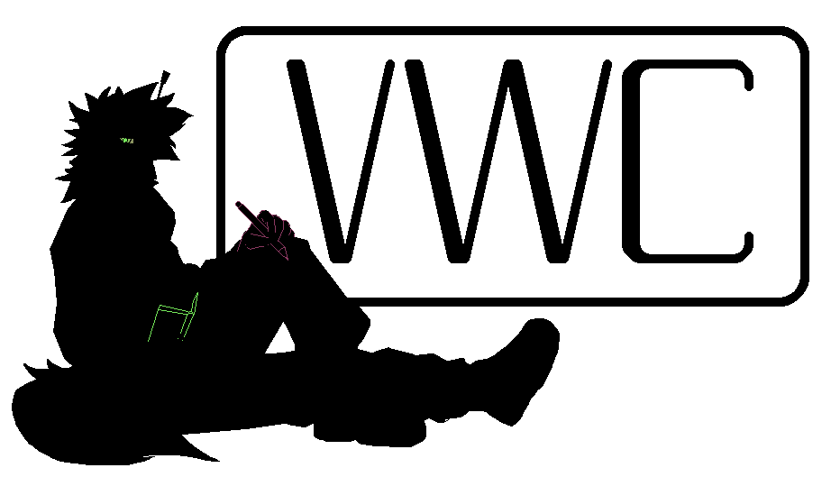

<p align="center">
  
</p>

# VRChat World Checker
Paste a world ID (or a vrchat.com link) and get a *predicted assumption*: **Possibly safe**, **Hmmmmm...**, or **Don't ffs!**, complete with the metadata, reasons and charts!

# Installation
Install Python 3.10+ from [here](https://www.python.org/downloads/) (MAKE SURE YOU CHOOSE ADVANCED OPTIONS AND SELECT THE "Add a PATH" CHECKBOX!!!)
(On linux you just run a command on your shell and you're done lol (well, you need to setup a venv first))

Then run this on the directory:
```bash
pip install -r requirements.txt
```

## Linux note: Tkinter is often a separate package.
```bash
sudo apt install python3-tk        # Debian/Ubuntu
sudo dnf install python3-tkinter   # Fedora
```

# Ok but how do me run??
Open the cmd on the same dir you are and type on of these 3 commands:

```bash
python main.py                                                    # User Interface
python main.py wrld_xxxxxxxx-xxxx-xxxx-xxxx-xxxxxxxxxxxx          # Command Line Interface
python main.py <world id or link> --json                          # Command Line Interface and spats out a JSON file with the output
```

## Note 1:
World ID: wrld_xxxxxxxx-xxxx-xxxx-xxxx-xxxxxxxxxxxx
Link    : `https://vrchat.com/worlds/wrld_xxxxxxxx-xxxx-xxxx-xxxx-xxxxxxxxxxxx`


# Logging
Log in with your VRChat account (2FA supported). The password is never stored! Only the session cookies are cached in `~/.config/vrc-world-checker/` (Linux) or `%APPDATA%\vrc-world-checker\` (Windows). Consider using a secondary account if you wish!

## Note 2:
Loggin in is not required! Its used for things like the block list, if you are sus abt this then you can inspect the source (or torture another dev to read it and translate for you lol, you'll want to look for vrc_api.py!)


# LIMITATIONS!!!
VRChat's API has **no reviews, no report counts, and no "this world has rippers" flag (but it should smh...)**.
It only gives metadata. So the verdict is an **estimated assumption** built from the:

- rip-bait wording ("free public avatars", "avatar dump", etc) in name, description and tags
- if the author's other worlds look the same
- world age, visits vs favorites, single-world(you can use as a hint for AI too!) authors, missing desc
- trust (older world, established author, `system_approved` tag)

It *will* have false positives and false negatives. Use this as a hint!

The **Add to blocklist** button stores world and author IDs in `blocklist.json` (same %APPDATA%\vrc-world-checker folder!), and
anything on it is rated "dont ffs". You can edit that file by hand or share it. (login required)

Tune the weights and thresholds at the top of `analyzer.py`.

# Also...
VRChat doesn't officially support third-party API use, keep request volume low and follow their ToS!

## Note 3:
Once you finish an analyzation, it will give you a confidence level.
It's *Never* high because this is a assumption. Low when there's little data to review

### Last note:
There are executables for people who just want the executable file and not have to deal with the whole python installation process, but remember that that means you won't be able to change configs! Although for a general user, I'd recommend the execs.
